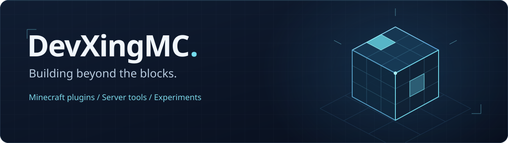

  

  <picture>
    <source media="(prefers-reduced-motion: reduce)" srcset="./assets/tagline.svg" />
    
  </picture>

  你好，我是 <strong>DevXingMC</strong>。 

  <a href="https://github.com/DevXingMC?tab=repositories">浏览仓库</a>
  &nbsp; / &nbsp;
  <a href="#projects">项目精选</a>
  &nbsp; / &nbsp;
  <a href="#activity">开发足迹</a>

 

### 正在探索

Minecraft 插件生态、服务器工具，以及用 AI 辅助理解代码。

  

Java &nbsp; · &nbsp; TypeScript &nbsp; · &nbsp; JavaScript &nbsp; · &nbsp; Git

 

### 项目精选

**[REAinMC](https://github.com/DevXingMC/REAinMC)** 
针对MC的逆向工程 
Fork from <a href="https://github.com/morluto/rea">morluto/rea</a>

 

### 开发足迹

  
  

  <picture>
    <source media="(prefers-color-scheme: dark)" srcset="./assets/github-snake-dark.svg" />
    
  </picture>

公开统计每日更新

 

  
关于这些组件

   

  横幅：[Capsule Render](https://github.com/kyechan99/capsule-render) ·

  

